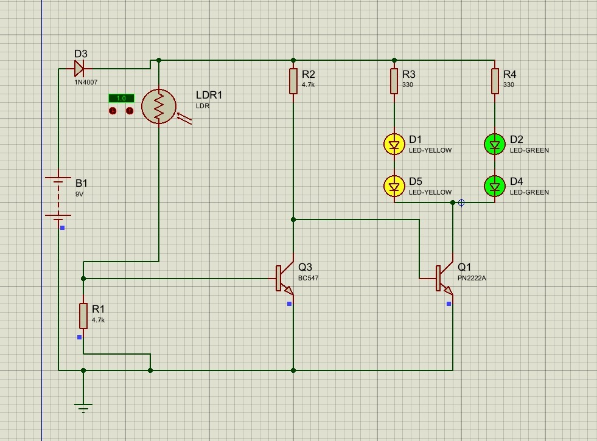
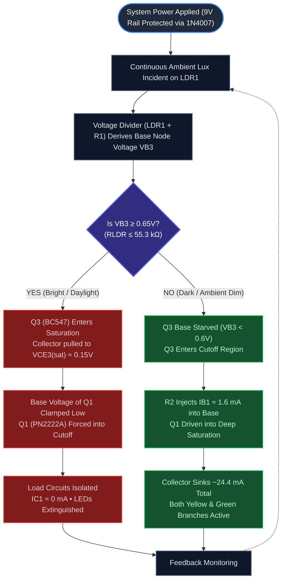
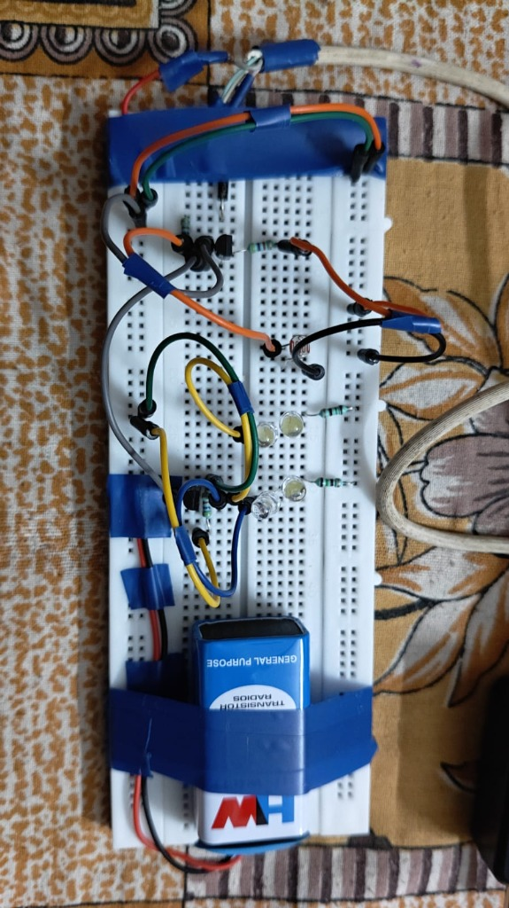
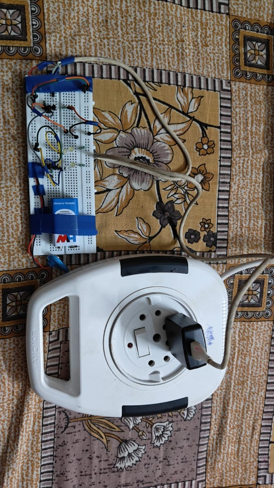
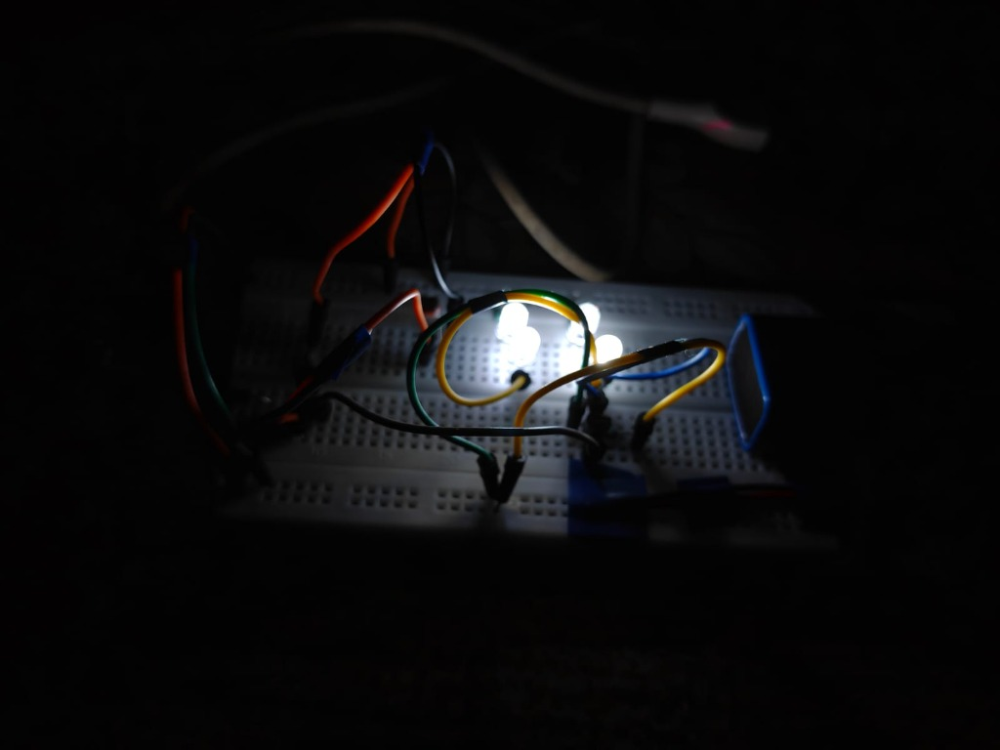

<div align="center">

# 💡 Automatic Light Detection & Switching Circuit
### Dual-Stage BJT Cascade Architecture with Photoresistive Threshold Sensing

[](LICENSE)
[]()
[]()
[]()
[]()

A solid-state, discrete analog control system designed to continuously monitor ambient luminous intensity and autonomously drive multi-branch LED arrays without requiring microcontrollers, programmable firmware, or external clock generation.

---

[Key Highlights](#-key-highlights) •
[Circuit Schematic](#-schematic-diagram) •
[Transistor Cascade Theory](#-mathematical-derivation--transistor-cascade-analysis) •
[Operation Flowchart](#-system-logic-flowchart) •
[Hardware Build](#-hardware-assembly--real-world-prototyping) •
[Bench Observations](#-experimental-observations) •
[Authors](#-authors--academic-credits)

---

</div>

## 📌 Key Highlights

- **Pure Autonomous Analog Switching:** Eliminates quiescent microcontroller current, firmware bugs, and boot-up latency.
- **Cascaded Dual-BJT Inverter:** Employs a low-noise, high-gain preamplifier stage (**BC547**) cascaded into a high-current saturation driver (**PN2222A**).
- **Reverse Polarity Safeguard:** Integrated **1N4007** inline blocking diode guards semiconductor junctions against reverse battery installation.
- **Split-Branch Indicator Array:** Symmetrical parallel branches featuring current-limiting ballast resistors ($330\,\Omega$) governing dual series yellow and green LEDs.

---

## 📐 Schematic Diagram

The complete schematic was designed and validated in **Proteus Design Suite**:

<div align="center">
  
  <p><em>Figure 1: Complete circuit schematic illustrating sensing divider, inverter stage Q3, switching driver Q1, and parallel load arrays.</em></p>
</div>

### Sub-Circuit Breakdown

1. **Power Conditioning Block:** 
   - $B_1$ ($9\,\text{V}$) connected via $D_3$ ($1\text{N}4007$).
   - Forward barrier potential reduction: $V_{\text{rail}} = V_{\text{batt}} - V_D \approx 9.0\,\text{V} - 0.7\,\text{V} = 8.3\,\text{V}$.
2. **Voltage Divider Sensing Network:**
   - Upper branch: Cadmium Sulfide ($CdS$) Light Dependent Resistor ($\text{LDR}_1$).
   - Lower branch: Fixed precision pull-down resistor $R_1$ ($4.7\,\text{k}\Omega$).
3. **Primary Sensing & Signal Inverter ($Q_3$):**
   - Transistor: **BC547** NPN.
   - Converts analog divider voltage $V_{B3}$ into collector-to-emitter pull-down logic.
4. **Intermediate Pull-Up Driver ($R_2$):**
   - $R_2$ ($4.7\,\text{k}\Omega$) establishes base drive for $Q_1$ when $Q_3$ is non-conductive.
5. **High-Current Output Stage ($Q_1$):**
   - Transistor: **PN2222A** NPN.
   - Collector sinks load current across parallel LED strings.
6. **Optical Load Array:**
   - Branch 1: $R_3$ ($330\,\Omega$) in series with Yellow LEDs $D_1, D_5$.
   - Branch 2: $R_4$ ($330\,\Omega$) in series with Green LEDs $D_2, D_4$.

---

## 🧮 Mathematical Derivation & Transistor Cascade Analysis

The circuit operates via a non-linear two-stage inverter cascade governed by BJT operating regions: **Cutoff**, **Active**, and **Saturation**.

```
                [ Rail +8.3V ]
                      │
            ┌─────────┴─────────┐
            │                   │
         [LDR1]                [R2]
            │                 4.7kΩ
     VB3 ───┴───┐               │
                │          VC3 ─┴───► Base Q1
             Base Q3            │
                │            Collector Q3
              [Q3]              │
             BC547             [Q1] PN2222A ──► LED Arrays
```

### 1. Light Sensing Divider Network

The voltage presented to the base of $Q_3$ ($V_{B3}$) is determined by:

$$V_{B3} = V_{\text{rail}} \cdot \left( \frac{R_1}{R_1 + R_{\text{LDR}}} \right)$$

Under nominal room ambient conditions ($V_{\text{rail}} \approx 8.3\,\text{V}$, $R_1 = 4.7\,\text{k}\Omega$):

$$\text{Switching Threshold: } V_{B3} \ge V_{BE(\text{on})} \approx 0.65\,\text{V}$$

Solving for the critical transition resistance $R_{\text{LDR(th)}}$:

$$R_{\text{LDR(th)}} = R_1 \cdot \left( \frac{V_{\text{rail}}}{V_{B3}} - 1 \right) = 4.7\,\text{k}\Omega \cdot \left( \frac{8.3\,\text{V}}{0.65\,\text{V}} - 1 \right) \approx 55.31\,\text{k}\Omega$$

- **Illuminated State ($R_{\text{LDR}} < 55.3\,\text{k}\Omega$):** $V_{B3} > 0.65\,\text{V}$
- **Obscured State ($R_{\text{LDR}} > 55.3\,\text{k}\Omega$):** $V_{B3} < 0.60\,\text{V}$

---

### 2. State Analysis: Daylight / Illuminated State

```
LDR illuminated (RLDR ~ 1kΩ - 10kΩ)
       │
       ▼
VB3 rises to ~ 2.6V - 6.8V  (>> 0.65V)
       │
       ▼
Q3 forward biased into Deep Saturation (VCE3(sat) ≈ 0.15V)
       │
       ▼
Base of Q1 clamped to VCE3(sat) = 0.15V < VBE(cut-in) (0.55V)
       │
       ▼
Q1 forced into Hard Cutoff (IB1 = 0, IC1 ≈ 0)
       │
       ▼
Load branches open-circuited ──► LEDs OFF
```

- In this mode, collector current through $Q_3$ is:
  
  $$I_{C3} \approx \frac{V_{\text{rail}} - V_{CE3(\text{sat})}}{R_2} = \frac{8.3\,\text{V} - 0.15\,\text{V}}{4.7\,\text{k}\Omega} \approx 1.73\,\text{mA}$$

- Power consumed by the control stage is negligible ($P_{Q3} = V_{CE3(\text{sat})} \cdot I_{C3} \approx 0.26\,\text{mW}$).

---

### 3. State Analysis: Darkness / Sensor Obscured

```
LDR obscured (RLDR > 100kΩ - 1MΩ)
       │
       ▼
VB3 drops below 0.3V (<< 0.60V)
       │
       ▼
Q3 drops into Cutoff (IC3 ≈ 0)
       │
       ▼
R2 delivers uninhibited base drive into Q1:
IB1 = (Vrail - VBE1(sat)) / R2 ≈ (8.3V - 0.75V) / 4.7kΩ ≈ 1.61 mA
       │
       ▼
Q1 driven into Deep Saturation (VCE1(sat) ≈ 0.18V)
       │
       ▼
Collector sinks full load current ──► LEDs GLOW AT FULL BRILLIANCE
```

#### Verification of Saturation Overdrive for Output Transistor $Q_1$:

For standard PN2222A switching:
- Load current per yellow branch ($V_{FY} \approx 2.0\,\text{V} \times 2 = 4.0\,\text{V}$):
  $$I_{\text{branch1}} = \frac{V_{\text{rail}} - 2V_{FY} - V_{CE1(\text{sat})}}{R_3} = \frac{8.3\,\text{V} - 4.0\,\text{V} - 0.18\,\text{V}}{330\,\Omega} \approx 12.48\,\text{mA}$$

- Load current per green branch ($V_{FG} \approx 2.1\,\text{V} \times 2 = 4.2\,\text{V}$):
  $$I_{\text{branch2}} = \frac{V_{\text{rail}} - 2V_{FG} - V_{CE1(\text{sat})}}{R_4} = \frac{8.3\,\text{V} - 4.2\,\text{V} - 0.18\,\text{V}}{330\,\Omega} \approx 11.88\,\text{mA}$$

- Total Collector Sink Current:
  $$I_{C1(\text{total})} = I_{\text{branch1}} + I_{\text{branch2}} = 12.48\,\text{mA} + 11.88\,\text{mA} \approx 24.36\,\text{mA}$$

- Forced Beta Ratio ($\beta_{\text{forced}}$):
  $$\beta_{\text{forced}} = \frac{I_{C1(\text{total})}}{I_{B1}} = \frac{24.36\,\text{mA}}{1.61\,\text{mA}} \approx 15.13$$

Since minimum DC current gain $h_{FE(\min)}$ of PN2222A exceeds $100$, an operating $\beta_{\text{forced}} \approx 15.1$ provides an **overdrive factor $> 6.5\times$**, guaranteeing low $V_{CE}$ saturation voltage and minimal thermal dissipation ($P_{D1} \approx 4.4\,\text{mW}$).

---

## 🔀 System Logic Flowchart



---

## 🛠️ Hardware Assembly & Real-World Prototyping

The physical prototype was constructed, wired, and tested on a standard breadboard using discrete through-hole components.

<div align="center">
  <table>
    <tr>
      <td align="center" width="50%">
        
        <br/>
        <em><b>Figure 2:</b> Top-down layout of breadboard wiring, discrete components, and 9V power block.</em>
      </td>
      <td align="center" width="50%">
        
        <br/>
        <em><b>Figure 3:</b> Complete bench test setup with power distribution harness.</em>
      </td>
    </tr>
  </table>
</div>

### Night Activation Demonstration

When ambient light levels drop below the programmed threshold ($R_{\text{LDR}} > 55.3\,\text{k}\Omega$), both LED branches activate immediately:

<div align="center">
  
  <p><em>Figure 4: Automated activation in low-light environment — dual branches active at rated forward currents.</em></p>
</div>

---

## 📋 Bill of Materials (BOM)

| Designator | Component Specification | Package | Qty | Functional Role |
|:----------:|:------------------------|:-------:|:---:|:----------------|
| **$B_1$** | $9\,\text{V}$ Alkaline Battery | 6F22 Snap | 1 | Primary DC Power Source |
| **$D_3$** | 1N4007 Standard Rectifier | DO-41 | 1 | Reverse polarity blocking ($V_{\text{RRM}} = 1000\,\text{V}$) |
| **$\text{LDR}_1$** | Cadmium Sulfide (CdS) Photoresistor | $5\,\text{mm}$ Radial | 1 | Light intensity transducer |
| **$R_1$** | $4.7\,\text{k}\Omega \pm 5\%$, $0.25\,\text{W}$ | Axial CFR | 1 | Potential divider lower arm reference |
| **$R_2$** | $4.7\,\text{k}\Omega \pm 5\%$, $0.25\,\text{W}$ | Axial CFR | 1 | Driver stage pull-up resistor |
| **$R_3, R_4$** | $330\,\Omega \pm 5\%$, $0.25\,\text{W}$ | Axial CFR | 2 | Series LED current limiters |
| **$Q_3$** | BC547 NPN Bipolar Transistor | TO-92 | 1 | Small-signal sensor inverter stage |
| **$Q_1$** | PN2222A NPN Bipolar Transistor | TO-92 | 1 | High-current output sinking switch |
| **$D_1, D_5$** | Diffused Yellow LED | $5\,\text{mm}$ Through-hole | 2 | Optical indicator branch 1 ($V_F \approx 2.0\,\text{V}$) |
| **$D_2, D_4$** | Diffused Green LED | $5\,\text{mm}$ Through-hole | 2 | Optical indicator branch 2 ($V_F \approx 2.1\,\text{V}$) |

---

## 🔬 Experimental Observations

| Ambient Illumination Regimes | Sensor Resistance ($R_{\text{LDR}}$) | Transistor $Q_3$ State | Transistor $Q_1$ State | Indicator Status | Total Current |
|:---|:---:|:---:|:---:|:---:|:---:|
| **Direct Incandescent / Torch** | $\sim 500\,\Omega - 2\,\text{k}\Omega$ | Saturated ($V_{CE} \approx 0.15\text{V}$) | Cutoff | Extinguished | $\sim 1.7\,\text{mA}$ |
| **Ambient Classroom / Lab Ambient** | $\sim 8\,\text{k}\Omega - 25\,\text{k}\Omega$ | Saturated | Cutoff | Extinguished | $\sim 1.9\,\text{mA}$ |
| **Twilight / Partial Shadowing** | $\sim 45\,\text{k}\Omega - 60\,\text{k}\Omega$ | Linear Active Transition | Linear Active | Incipient Glow | $\sim 5 - 14\,\text{mA}$ |
| **Total Darkness (Fully Covered)** | $> 250\,\text{k}\Omega$ | Cutoff ($V_{BE} < 0.2\text{V}$) | Saturated ($V_{CE} \approx 0.18\text{V}$) | High Intensity | $\sim 26.1\,\text{mA}$ |

---

## ⚖️ Engineering Trade-Offs & Future Enhancements

```
┌──────────────────────────────────────┬──────────────────────────────────────┐
│        Current Implementations       │         Proposed Architecture        │
├──────────────────────────────────────┼──────────────────────────────────────┤
│ Fixed R1 (4.7kΩ) divider reference   │ Multi-turn 10kΩ Cermet Potentiometer │
│  ↳ Threshold fixed by component tol  │  ↳ User-calibrated Lux switching     │
├──────────────────────────────────────┼──────────────────────────────────────┤
│ Soft linear transition at threshold  │ Schmitt Trigger / LM393 Comparator   │
│  ↳ Slight flicker in twilight        │  ↳ Sharp switching with hysteresis   │
├──────────────────────────────────────┼──────────────────────────────────────┤
│ Direct LED branch collector sink     │ Electromechanical Relay / Power FET  │
│  ↳ Limited to small DC indicators    │  ↳ 230V AC mains load automation     │
└──────────────────────────────────────┴──────────────────────────────────────┘
```

---

## 👥 Authors & Academic Credits

Developed under the **Department of Electronics and Communication Engineering (ECE)**:
**Institute of Engineering & Management (IEM), Kolkata**

| Member | Roll Number | Enrollment Number | Academic Session |
|:-------|:-----------:|:-----------------:|:----------------:|
| **Mayukh Bhattacharjee** | 240 | 12025052003258 | 2026 – 2027 |
| **Siddhartha Saha** | 237 | 12025052003255 | 2026 – 2027 |

* **Course:** Bachelor of Technology (B.Tech)
* **Laboratory:** Analog Electronics Laboratory
* **Mentorship:** Sutapa Ray Adhikary Mam

---

## 📄 License

This repository and all associated documentation, schematics, and media are released under the [MIT License](LICENSE).

```text
Copyright (c) 2024-2027 Siddhartha Saha & Mayukh Bhattacharjee
```
